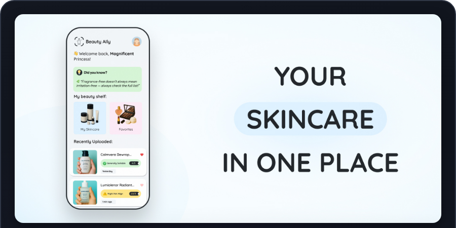
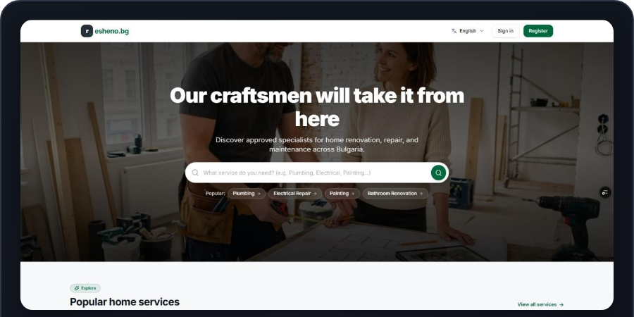
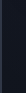
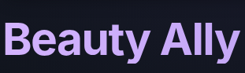
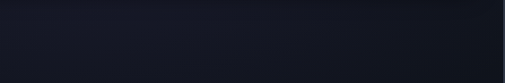
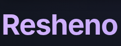
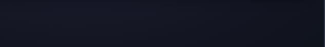
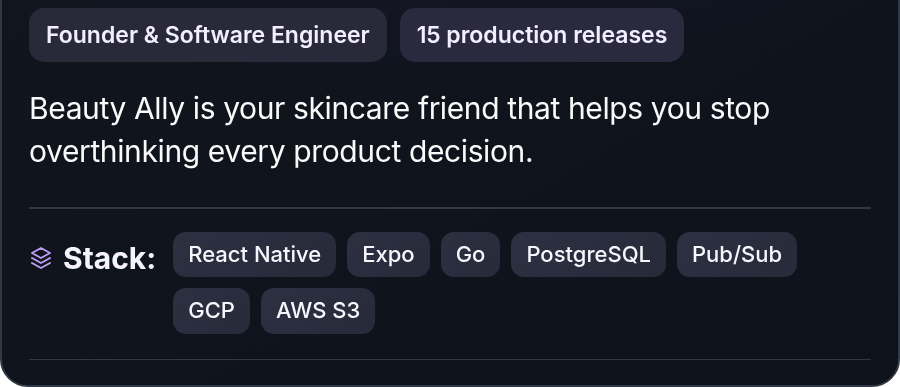
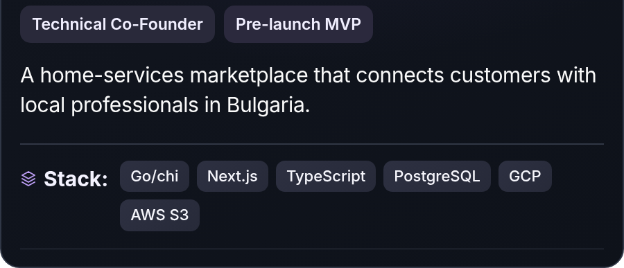

# Hey, I'm Alex 👋

**Software Engineer · Go & TypeScript · Backend / Full-Stack**

🟢 **Open to Work** - Backend, Full-Stack & Product Engineering roles  
📍 Sofia, Bulgaria · Open to remote opportunities and relocation

I'm a **product-minded software engineer** who enjoys building things end to end, from understanding the problem to designing the system, writing the code, and shipping it to real users.

## Connect with me

  
  
  
  

## Featured Projects

<!-- Preview images and product title strips have separate links. Details are plain images. -->

   
   
  

<!-- These are the original neutral GitHub badge links, not links baked into the card images. -->

  <strong>Beauty Ally</strong> 
  
  
   
  
  
  

  <strong>Resheno screenshots</strong> 
  
  
  
  
  

## Open Source

-  **[Fuel Labs - Sway Playground - Dark Theme (PR #83)](https://github.com/FuelLabs/sway-playground/pull/83)** - added shared theme state, system-preference detection, and dark-theme support for the editor and UI.

## Tech Stack

