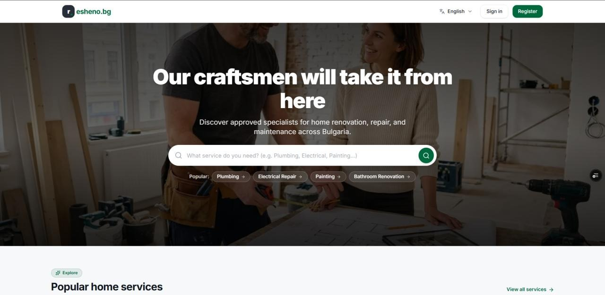

# Hey, I'm Alex 👋

**Software Engineer · Go & TypeScript · Backend / Full-Stack**

 **Backend, Full-Stack & Product Engineering roles**  
📍 Sofia, Bulgaria · Open to remote opportunities and relocation

I'm a **product-minded software engineer** who enjoys building things end to end, from understanding the problem to designing the system, writing the code, and shipping it to real users.

## Connect with me

  
  
  
  

## Featured Projects

<table>
  <tr>
    <td width="50%" valign="top">
      
      <h3>Beauty Ally</h3>
      
<b>Founder & Software Engineer · 15 production releases</b>

      
A skincare companion for iOS and Android that helps people scan cosmetics, get personalized product insights, and organize their routines.

      
<b>Stack:</b> React Native, Expo, Go, PostgreSQL, Pub/Sub, Cloud Run, AWS S3

      
Go backend, asynchronous processing, cloud deployments, and automated CI/CD for production releases.

      

        
        
        
      

      

        
        
        
      

    </td>
    <td width="50%" valign="top">
      
      <h3>Resheno</h3>
      
<b>Technical Co-Founder · Pre-launch MVP</b>

      
A home-services marketplace that connects customers with local professionals in Bulgaria.

      
<b>Stack:</b> Go/chi, Next.js, TypeScript, PostgreSQL, Cloud Run

      
Implemented role-based access, approval and moderation workflows, request assignments, CI/CD, and monitoring.

      

        
        
        
        
        
      

    </td>
  </tr>
</table>

## Open Source

-  **[Fuel Labs - Sway Playground - Dark Theme (PR #83)](https://github.com/FuelLabs/sway-playground/pull/83)** - added shared theme state, system-preference detection, and dark-theme support for the editor and UI.

## Tech Stack

