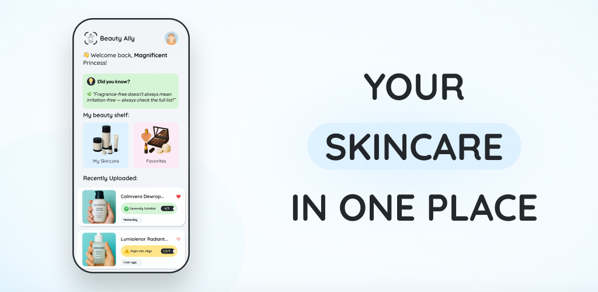

# Hey, I'm Alex 👋

**Software Engineer · Go & TypeScript · Backend / Full-Stack**

**🟢 Open to Work — Backend, Full-Stack & Product Engineering roles**  
📍 Sofia, Bulgaria · Open to remote opportunities and relocation

I'm a **product-minded software engineer** who enjoys building things end to end — understanding the problem, designing the system, writing the code, and shipping it to real users.

## Connect with me

  
  
  
  

## Featured Projects

<table>
  <tr>
    <td width="50%" valign="top">
      
      <h3>Beauty Ally</h3>
      
<b>iOS & Android · 14 production releases</b>

      
Built and launched a skincare companion to scan cosmetics, get personalized product insights, and organize routines.

      
<b>Stack:</b> React Native, Expo, Go, PostgreSQL, Pub/Sub, Cloud Run, AWS S3

      

        <a href="https://apps.apple.com/ua/app/beauty-ally/id6749963321">App Store</a> ·
        <a href="https://play.google.com/store/apps/details?id=com.sycrafted.beautyai">Google Play</a> ·
        <a href="https://github.com/alexprimak24/beauty-ally-mobile">Source</a>
      

      

        <a href="https://www.tiktok.com/@yourbeautyally">TikTok</a> ·
        <a href="https://www.youtube.com/@yourbeautyally">YouTube</a> ·
        <a href="https://www.instagram.com/yourbeautyally/">Instagram</a>
      

    </td>
    <td width="50%" valign="top">
      
      <h3>Resheno</h3>
      
<b>Technical Co-Founder · Pre-launch MVP</b>

      
Built a home-services marketplace for connecting customers with local professionals in Bulgaria.

      
<b>Stack:</b> Go/chi, Next.js, TypeScript, PostgreSQL, Cloud Run

      
Implemented role-based access, approval and moderation workflows, request assignments, CI/CD, and monitoring.

    </td>
  </tr>
</table>

## Open Source & Engineering

- **[Fuel Labs · Sway Playground — Dark Theme](https://github.com/FuelLabs/sway-playground/pull/83)** — merged upstream. Added shared theme state, system-preference detection, and dark-theme support for the editor and UI.
- **[Toy HTTP from TCP](https://github.com/alexprimak24/toy-http-from-tcp)** — exploring HTTP at the TCP and byte-stream level.

## Tech Stack

## GitHub Activity

  

