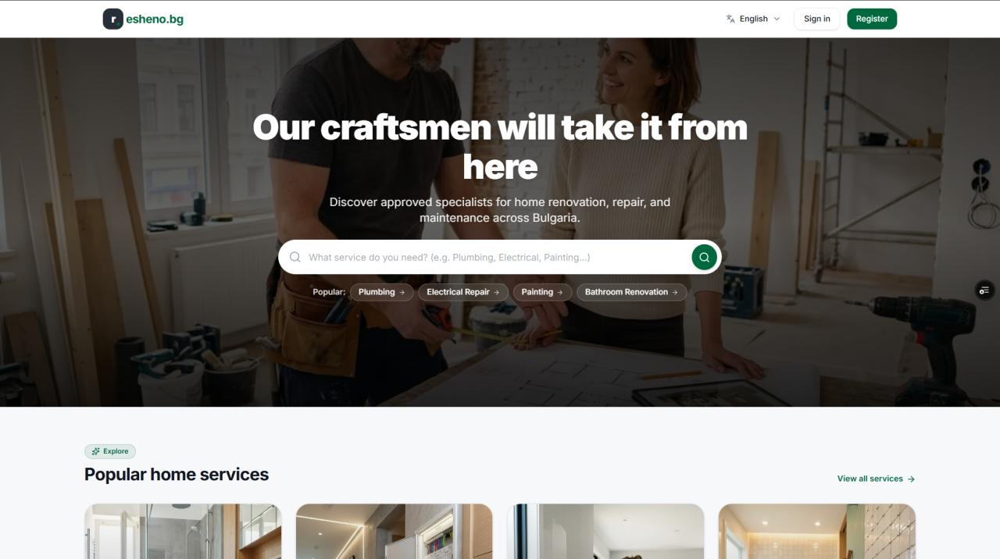

# Hey, I'm Alex 👋

**Software Engineer · Go & TypeScript · Backend / Full-Stack**

**🟢 Open to Work — Backend, Full-Stack & Product Engineering roles**  
📍 Sofia, Bulgaria · Open to remote opportunities and relocation

I'm a **product-minded software engineer** who enjoys building things end to end — understanding the problem, designing the system, writing the code, and shipping it to real users.

## 🚀 What I've Built

### Beauty Ally — skincare companion for iOS & Android

Built and launched a mobile app that helps people scan cosmetics, get personalized product insights, and organize their skincare routines. **Shipped 14 production releases.**

- **Mobile:** React Native, Expo, TypeScript
- **Backend:** Go, PostgreSQL, asynchronous workers, Google Cloud Pub/Sub
- **Infrastructure:** Cloud Run, AWS S3, GitHub Actions CI/CD

**[Website](https://beautyally.app/en) · [App Store](https://apps.apple.com/ua/app/beauty-ally/id6749963321) · [Google Play](https://play.google.com/store/apps/details?id=com.sycrafted.beautyai) · [Open-source frontend](https://github.com/alexprimak24/beauty-ally-mobile)**

Product journey & content: [TikTok](https://www.tiktok.com/@yourbeautyally) · [YouTube](https://www.youtube.com/@yourbeautyally) · [Instagram](https://www.instagram.com/yourbeautyally/)

### Resheno — home-services marketplace (pre-launch MVP)

As technical co-founder, built a marketplace for finding and connecting with local home-service professionals in Bulgaria.

- Built the **Go/chi REST API**, **Next.js** frontend, and **PostgreSQL** data layer.
- Implemented role-based access, approval and moderation workflows, and request-assignment logic.
- Set up development, staging, and production deployments, with CI/CD, monitoring, and error tracking.

More screenshots: [Admin dashboard](assets/resheno/admin-dashboard.jpg) · [Professionals directory](assets/resheno/professionals.jpg) · [Professional profile](assets/resheno/professional-profile.jpg) · [Account dashboard](assets/resheno/account-dashboard.jpg)

## 🌱 Open Source

**[Fuel Labs · Sway Playground — dark theme (merged PR #83)](https://github.com/FuelLabs/sway-playground/pull/83)**  
Added theme state, system-preference detection, and dark-theme support across the editor and UI. Merged upstream after maintainer review.

## 🔬 Engineering Projects

**[Toy HTTP from TCP](https://github.com/alexprimak24/toy-http-from-tcp)** — exploring how HTTP works at the TCP and byte-stream level.

## 🛠 Tech Stack

