<h3><picture><source media="(prefers-color-scheme: light)" srcset="assets/headings/intro-light.svg"></picture></h3>

**Software Engineer · Go & TypeScript · Backend / Full-Stack**

🟢 **Open to Work** - Backend, Full-Stack & Product Engineering roles  
📍 Sofia, Bulgaria · Open to remote opportunities and relocation

I'm a **product-minded software engineer** who enjoys building things end to end, from understanding the problem to designing the system, writing the code, and shipping it to real users.

<h3><picture><source media="(prefers-color-scheme: light)" srcset="assets/headings/connect-light.svg"></picture></h3>

  
  
  
  

<h3><picture><source media="(prefers-color-scheme: light)" srcset="assets/headings/featured-light.svg"></picture></h3>

<!-- Project preview/name and each button are independently clickable. Cards use tiled image strips to avoid GitHub HTML table borders. -->

<a href="https://apps.apple.com/ua/app/beauty-ally/id6749963321">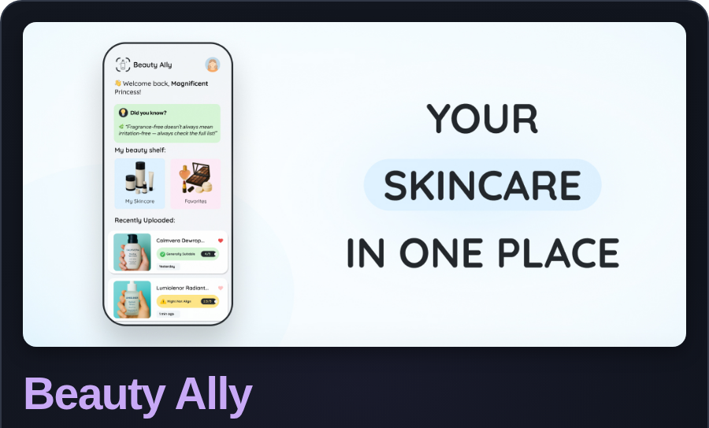</a><a href="assets/resheno/landing.jpg">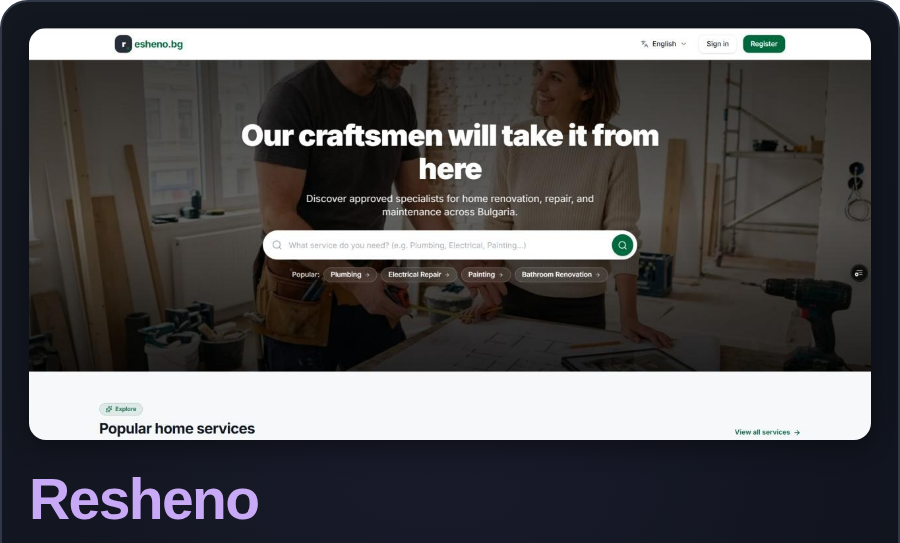</a> 
 
<a href="https://apps.apple.com/ua/app/beauty-ally/id6749963321">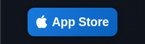</a><a href="https://play.google.com/store/apps/details?id=com.sycrafted.beautyai">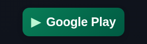</a><a href="https://github.com/alexprimak24/beauty-ally-mobile">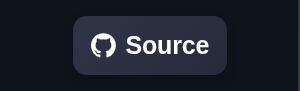</a><a href="assets/resheno/landing.jpg">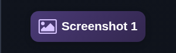</a><a href="assets/resheno/admin-dashboard.jpg">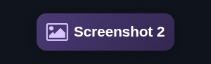</a><a href="assets/resheno/professionals.jpg">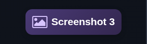</a> 
<a href="https://www.tiktok.com/@yourbeautyally">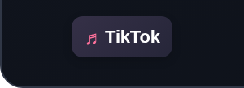</a><a href="https://www.youtube.com/@yourbeautyally">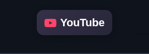</a><a href="https://www.instagram.com/yourbeautyally/">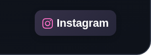</a><a href="assets/resheno/professional-profile.jpg">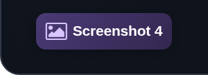</a><a href="assets/resheno/account-dashboard.jpg">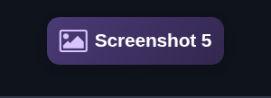</a>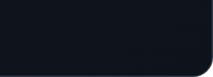 

<h3><picture><source media="(prefers-color-scheme: light)" srcset="assets/headings/open-source-light.svg"></picture></h3>

-  **[Fuel Labs - Sway Playground - Dark Theme (PR #83)](https://github.com/FuelLabs/sway-playground/pull/83)** - added shared theme state, system-preference detection, and dark-theme support for the editor and UI.

<h3><picture><source media="(prefers-color-scheme: light)" srcset="assets/headings/tech-stack-light.svg"></picture></h3>

